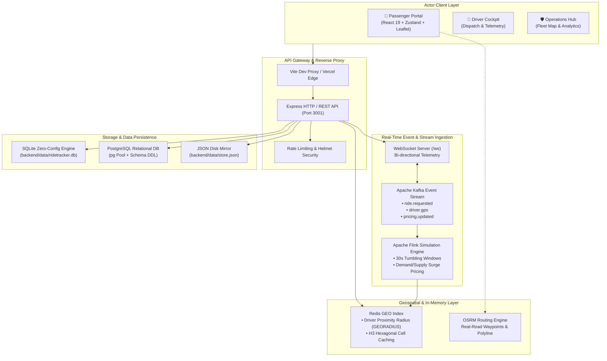

# 🚖 RideTracker — Distributed Real-Time Mobility & Fleet Intelligence Platform

[](https://react.dev/)
[](https://vitejs.dev/)
[](https://tailwindcss.com/)
[](https://nodejs.org/)
[](https://expressjs.com/)
[](https://www.postgresql.org/)
[](https://kafka.apache.org/)
[](https://redis.io/)
[](LICENSE)

---

## 🌟 Executive Overview

**RideTracker** is a high-throughput, distributed real-time mobility and fleet intelligence platform engineered for multi-modal transportation systems. Designed to handle both dense metropolitan transit ecosystems (Mumbai, Delhi-NCR, Bengaluru, Hyderabad, Chennai, Kolkata) and high-density campus transit hubs (such as IIT Kharagpur), RideTracker delivers sub-second geospatial telemetry, dynamic surge pricing via stream calculation algorithms, intelligent driver dispatching, and strict privacy-preserving passenger protections.

The platform provides a unified 3-tier operational experience:
1. **Passenger Web Portal** — Instant multi-modal ride booking, live 60 FPS driver telemetry tracking with OSRM street routing, dynamic split fares, and instant SOS emergency escalation.
2. **Driver Partner Cockpit** — Proximity dispatch acceptance, live turn-by-turn simulation, transparent 88% driver net earnings / 12% platform fee accounting, and real-time wallet settlement.
3. **Central Operations Command (Admin)** — National fleet live geospatial radar, H3 spatial demand/supply density heatmaps, real-time incident triage desk, and regulatory DPDP-compliant data masking.

---

## 🏗️ System Architecture



---

## 🚀 Key Platform Capabilities

### 1. 📱 Passenger Ride Experience
- **Interactive Geospatial Booking**: Integrated Leaflet + React-Leaflet maps with smooth panning, dynamic landmark search across Indian transit centers, and pin-drop pickup/destination selection.
- **Multi-Modal Vehicle Catalog**:
  - 🛵 **Moto / Bike** (Fast city navigation)
  - 🛺 **Auto Rickshaw / Campus Toto** (Affordable everyday transit)
  - 🚗 **RideMini & Economy Cab** (Reliable daily commute)
  - 🚘 **Prime Sedan & XL** (Executive travel & group transit)
  - ⚡ **Eco Green EV** (Zero-emission clean mobility)
- **Ultra-Smooth 60 FPS Telemetry**: Real-time driver bearing rotation and waypoint interpolation ensuring butter-smooth vehicle movement without jarring jumps.
- **Safety Desk & Emergency SOS**: Instant panic trigger sending live GPS coordinates and driver identification to local emergency authorities.
- **Fare Transparency & Split Billing**: Itemized base fare, distance, duration, taxes, and instant multi-passenger fare splitting.

### 2. 🚖 Driver Partner Cockpit
- **One-Tap Duty Management**: Instantly toggle `AVAILABLE`, `ON_RIDE`, or `OFFLINE` status.
- **Dispatch Radars**: Proximity-filtered incoming ride requests with pickup distance, estimated passenger fare, and one-click accept/decline.
- **Guaranteed Fair Commission**: Transparent 88% driver net earnings and 12% platform fee with direct instant withdrawal simulations to UPI (`@okaxis`, `@upi`).
- **Real-Time Ride Workflow**: Stage machine supporting `HEADING_TO_PICKUP` ➔ `ARRIVED` ➔ `IN_TRANSIT` ➔ `PAYMENT_PENDING` ➔ `COMPLETED`.

### 3. 🛡️ Operations Command Hub (Admin)
- **Pan-India Fleet Radar**: Live tracking of thousands of active vehicles across major Indian metropolitan centers (Mumbai, Delhi-NCR, Bengaluru, Hyderabad, Chennai, Kolkata, and IIT Kharagpur).
- **Dynamic Surge & Heatmap Control**: Real-time surge multiplier visibility per zone (1.0x to 3.0x max ceiling) based on stream calculations.
- **DPDP Act Compliance**: Built-in phone number masking and personal information obfuscation according to India's Digital Personal Data Protection Act.
- **Incident Management**: Severity-rated triage for SOS alerts, speeding warnings, and vehicle breakdowns.

### 4. ⚡ Event-Driven Engine & Flink Dynamic Pricing
- **Stream Ingestion**: Kafka topics configured for `ride.requested`, `driver.gps`, and `pricing.updated`.
- **Surge Formula**:
  $$\text{Surge Ratio} = \frac{\text{Ride Demand}}{\text{Available Driver Supply}}$$
  - Ratio $\ge 3.0 \implies 3.0\times$ (System maximum cap)
  - Ratio $\ge 2.0 \implies 2.5\times$
  - Ratio $\ge 1.5 \implies 2.0\times$
  - Ratio $\ge 1.2 \implies 1.5\times$
  - Default $\implies 1.0\times$ (Normal baseline)

---

## 🔑 Pre-Configured Demo Credentials

To test any role immediately without manual registration, use the following pre-seeded credentials:

| Role | Email | Password | Access Scope |
| :--- | :--- | :--- | :--- |
| **Operations Admin** | `admin@ridetracker.in` | `admin123` | Full access across Admin, Driver, and Passenger modules |
| **Driver Partner** | `driver@ridetracker.in` | `password123` | Driver Dashboard, Ride Dispatching, Earnings |
| **Passenger** | `passenger@ridetracker.in` | `password123` | Ride Booking, Live Tracking, Trips, Profile |

> **Operations Admin Passkey**: For new admin signups, use the secret code: `ADMIN2026`.

---

## 🛠️ Technology Stack

| Layer | Technologies | Purpose |
| :--- | :--- | :--- |
| **Frontend UI** | React 19, Tailwind CSS v4, Lucide Icons | Modern, ultra-responsive design system |
| **Client Bundler** | Vite 8, React SWC / Babel Plugin | Sub-second HMR & optimized production bundling |
| **Client State** | Zustand 5, TanStack Query 5 | Global store and server-state caching |
| **Geospatial & Maps**| Leaflet, React-Leaflet, OSRM API | High-accuracy mapping, marker clustering, routing |
| **Charts & Metrics** | Recharts | Financial GMV, trip count, and driver supply graphs |
| **Backend Runtime** | Node.js (ESM modules), Express 4 | High-concurrency RESTful API service |
| **Security & Auth** | JWT (`jsonwebtoken`), `bcryptjs`, `helmet`, `cors` | Token-based auth, password hashing, header hardening |
| **Traffic Control** | `express-rate-limit` | DoS protection on sensitive endpoints |
| **Relational Storage**| SQLite (built-in zero-config), PostgreSQL | Transactional persistence for users, rides, and logs |
| **Streaming & Cache**| Redis GEO, Apache Kafka, Apache Flink Stubs | Geospatial querying and real-time streaming simulation |

---

## 📁 Repository Structure

```text
RideTracker/
├── backend/                        # Node.js + Express backend service
│   ├── data/                       # Persistent database storage
│   │   ├── ridetracker.db          # Embedded SQLite database
│   │   └── store.json              # Disk mirror state
│   ├── src/
│   │   ├── api/                    # REST API route controllers
│   │   │   ├── auth.js             # User/Driver/Admin authentication
│   │   │   ├── rides.js            # Booking, status updates, dispatch
│   │   │   ├── drivers.js          # Driver state, earnings, telemetry
│   │   │   ├── locations.js        # Geocoding & landmark lookup
│   │   │   ├── pricing.js          # Dynamic fare calculation
│   │   │   ├── analytics.js        # GMV and operational telemetry
│   │   │   ├── incidents.js        # Safety SOS and alert dispatch
│   │   │   └── users.js            # User management
│   │   ├── db/                     # Database connection & schema
│   │   │   ├── db.js               # Multi-engine adapter (SQLite / Postgres)
│   │   │   ├── pool.js             # PostgreSQL connection pool
│   │   │   └── schema.sql          # Relational SQL schema
│   │   ├── flink/                  # Apache Flink pricing stream logic
│   │   ├── kafka/                  # Kafka producer & consumer stubs
│   │   ├── middleware/             # JWT auth & role validation
│   │   ├── redis/                  # Redis client & GEO helpers
│   │   ├── utils/                  # DPDP privacy & phone masking helpers
│   │   ├── websocket/              # Real-time WebSocket server hub
│   │   └── server.js               # Express application entrypoint
│   ├── package.json
│   └── .env.example
│
├── frontend/                       # React 19 + Vite + Tailwind CSS v4
│   ├── public/                     # Static assets, branding, and icons
│   ├── src/
│   │   ├── assets/                 # SVGs and UI media
│   │   ├── components/             # Reusable UI components
│   │   │   ├── common/             # Modals, avatars, badges, toasts
│   │   │   ├── layout/             # Top navbar, bottom tabs, sidebars
│   │   │   ├── map/                # Leaflet interactive map components
│   │   │   └── shared/             # Cards, buttons, inputs
│   │   ├── constants/              # City zones, vehicle tiers, routes
│   │   ├── layouts/                # Public, User, Driver, and Admin layouts
│   │   ├── mock/                   # High-fidelity mock telemetry data
│   │   ├── pages/
│   │   │   ├── public/             # Landing, Driver Landing, Admin Portal, Login
│   │   │   ├── user/               # Passenger Home, Live Ride, Trip History
│   │   │   ├── driver/             # Driver Cockpit, Requests, Earnings, Profile
│   │   │   └── admin/              # Central Live Map, Fleet Management, Analytics
│   │   ├── services/               # API clients & telemetry stream generators
│   │   ├── stores/                 # Zustand state stores (Auth, Booking, Admin)
│   │   ├── App.jsx                 # Route hierarchy & role guards
│   │   └── main.jsx                # Application mounting entrypoint
│   ├── package.json
│   ├── vite.config.js
│   └── vercel.json
│
├── scripts/
│   └── generate_india_mock.js      # Synthetic telemetry generator (100k records)
├── package.json                    # Monorepo task orchestration
├── vercel.json                     # Edge deployment configuration
├── .gitignore                      # Git exclusion rules
└── README.md                       # Comprehensive platform documentation
```

---

## 🚦 Getting Started

### Prerequisites
- **Node.js**: v18.0.0 or higher
- **npm**: v9.0.0 or higher (or pnpm / yarn)
- **Git**

### 1. Clone the Repository
```bash
git clone https://github.com/dhruvahari27/RideTracker-Distributed-Real-Time-Mobility-Platform.git
cd RideTracker-Distributed-Real-Time-Mobility-Platform
```

### 2. Install Dependencies
You can install dependencies for both the frontend and backend:
```bash
# Install frontend packages
npm --prefix frontend install

# Install backend packages
npm --prefix backend install
```

### 3. Launch Development Servers

You can launch both services conveniently:

**Terminal 1 — Backend API Server (Port 3001):**
```bash
npm run dev:backend
```
*Health Check will be available at:* `http://127.0.0.1:3001/health`

**Terminal 2 — Frontend Application (Port 5173):**
```bash
npm run dev:frontend
```
*Open your browser at:* `http://localhost:5173`

---

## 🌐 API Reference

| Method | Endpoint | Description | Role Required |
| :--- | :--- | :--- | :--- |
| `POST` | `/api/v1/auth/signup` | Register new Passenger, Driver, or Admin | Public |
| `POST` | `/api/v1/auth/login` | Authenticate user & return signed JWT | Public |
| `GET` | `/api/v1/auth/me` | Fetch active profile from database | Authenticated |
| `GET` | `/api/v1/rides/active` | Get current live active ride with telemetry | User / Driver |
| `POST` | `/api/v1/rides/request` | Submit new ride request | User |
| `PATCH`| `/api/v1/rides/:id/status`| Update trip stage (ARRIVED, IN_TRANSIT, etc.) | Driver / Admin |
| `GET` | `/api/v1/drivers` | Fetch available drivers with geospatial coords | Authenticated |
| `GET` | `/api/v1/locations/search`| Search Indian cities, airports, and landmarks | Public |
| `POST` | `/api/v1/pricing/estimate`| Calculate dynamic fare with distance & surge | Public |
| `GET` | `/api/v1/analytics/overview`| Fetch system GMV, completion rates, and fleet count | Admin |
| `POST` | `/api/v1/incidents/report`| Dispatch instant SOS incident alert | Authenticated |

---

## 🚀 Deployment

### Frontend (Vercel)
The project includes a root `vercel.json` optimized for monorepo deployments:
```bash
# Deploy with Vercel CLI
vercel --prod
```
The rewrite configuration automatically proxies `/api/*` calls to the deployed backend while serving the SPA client with deep-linking support.

### Backend (Render / Railway / Docker)
The backend requires no external database for basic operation due to embedded SQLite support. Simply set environment variables:
```bash
PORT=3001
NODE_ENV=production
JWT_SECRET=your-secure-production-key
ADMIN_KEY=ADMIN2026
```

---

## 📄 License & Credits

Distributed under the **MIT License**. See `LICENSE` for more information.

Developed with precision by **[Dhruv Ahari](https://github.com/dhruvahari27)**.
